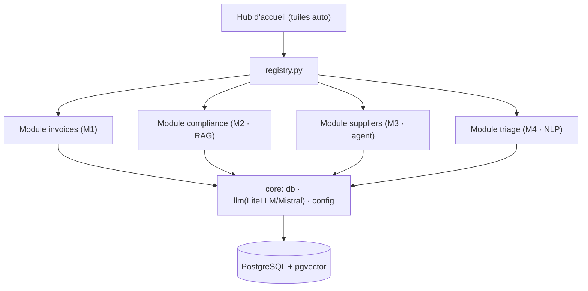

# Brief d'évolution v2 — AtelIA, plateforme de démonstration AI Engineering

> Document de cadrage (trio : Jérémy décide · Claude conseille/spec · Claude Code implémente).
> Fait suite au POC v1 (Module Factures, déployé sur atel-ia.fr). Ne pas coder avant validation du plan.

---

## 1. Vision

AtelIA passe d'un **POC mono-cas** (traitement de factures) à une **plateforme portfolio** : une vitrine qui démontre, cas d'usage à l'appui, une capacité à **intégrer l'IA en entreprise sur de la vraie donnée, avec la bonne technique pour chaque problème**.

- **Univers** : une PME agroalimentaire **fictive** (fil conducteur cohérent), jamais une entreprise réelle nommée.
- **Public** : plusieurs recruteurs / clients potentiels. Chaque cas est ancré agroalimentaire mais **transposable** à d'autres secteurs (finance, RH, conformité, industrie).
- **Objet** : un outil **interactif** où un visiteur se projette concrètement — il teste, il voit le résultat, il comprend la technique.

**Message à prouver** : *« Je ne connais pas un truc, je sais diagnostiquer un besoin métier et choisir la bonne approche IA — déterministe, RAG, agent, classification — sans plaquer un LLM partout. »* C'est la ligne de séparation entre un ingénieur IA et quelqu'un qui a branché une API.

---

## 2. Principes directeurs (garde-fous — à lire avant de coder)

1. **Un module à la fois, fini et déployé** avant le suivant (tranches verticales). À tout moment, la plateforme est présentable, jamais un chantier.
2. **La bonne technique pour le bon problème** — déterministe quand c'est fiable, RAG pour le documentaire, agent pour l'orchestration, classification pour le non-structuré. Si deux modules prouvent la même compétence, l'un est du remplissage.
3. **Vraie donnée publique** (API officielles, textes réglementaires) + **synthétique** là où le privé serait requis. **Jamais de donnée privée réelle.**
4. **Couche LLM agnostique** : Mistral souverain par défaut, swappable vers Claude en config (LiteLLM). Fil rouge de toute la plateforme.
5. **Contrôle humain** partout où il y a une écriture ou une décision engageante.
6. **Anonymisation stricte** : PME fictive, zéro mention d'entreprise réelle. Relecture obligatoire avant chaque déploiement.
7. **Anti-over-engineering** : chaque module = MVP démontrable d'abord, raffinement ensuite. Timebox par module.

---

## 3. Architecture cible : socle + modules enfichables

Le cœur du refactor : passer d'une app plate à un **socle commun** qui héberge des **modules autonomes**, listés dynamiquement par un **hub d'accueil**. C'est en soi une preuve d'architecture logicielle.

### Niveau conteneurs (inchangé)
FastAPI (Python) · PostgreSQL + pgvector · LiteLLM → Mistral (swappable Claude) · Docker/Coolify. Rien ne change côté infra : on réorganise le code applicatif.

### Structure de code cible
```
app/
  core/
    config.py          # settings (env)
    db.py              # pool asyncpg + application des schémas modules
    llm.py             # couche LiteLLM (complete/embed) — partagée
    registry.py        # registre des modules (router + schema + méta nav)
    main.py            # app factory : monte core + modules découverts
  modules/
    invoices/          # M1 (migration du code existant)
      router.py  extraction.py  repository.py  services.py
      schema.sql  templates/
    compliance/        # M2 (RAG)
    suppliers/         # M3 (agent + API)
    triage/            # M4 (classification, option)
  shared/
    templates/base.html   # layout + navigation vers les modules
    templates/home.html   # hub : tuiles des modules
    templates/about.html  # "Démarche" : le pitch technique
static/  samples/  scripts/  docs/
```

### Contrat d'un module (pattern enfichable)
Chaque module expose un objet standard consommé par `registry.py` :
- un **router** (routes API + UI du module) ;
- un **schema.sql** idempotent (le module possède ses tables, appliqué au démarrage) ;
- des **métadonnées de navigation** (slug, titre, problème résolu en une phrase, technique, icône).

Le **hub d'accueil** génère ses tuiles à partir de ce registre → ajouter un module = le déposer dans `modules/` et l'enregistrer, sans toucher au reste.



---

## 4. Les modules cadrés

Chaque carte : **problème** / **technique prouvée** / **data réelle** / **ce que ça démontre**.

### Module 1 — Factures fournisseurs *(déjà livré, à migrer tel quel)*
- **Problème** : saisie manuelle des factures (~26 €/facture ; réforme facture électronique 2026-2027).
- **Technique** : extraction **déterministe** (XML Factur-X) + validation + **human-in-the-loop**.
- **Data** : factures Factur-X synthétiques (profil EN 16931).
- **Démontre** : pipeline data structuré, déterminisme assumé (pas de LLM là où il n'apporte rien), contrôle humain, mesure de gains.

### Module 2 — Assistant conformité & qualité *(RAG sourcé)*
- **Problème** : un opérateur qualité/admin doit trouver une réponse réglementaire précise sans éplucher des PDF (allergènes, étiquetage, obligations facture élec, principes HACCP).
- **Technique** : **RAG** — chunking + embeddings (`mistral-embed`) dans **pgvector** + retrieval + génération **avec citations obligatoires**. Si la réponse n'est pas dans le corpus → l'assistant dit *« je ne sais pas »* (anti-hallucination).
- **Data réelle publique** : Règlement (UE) **1169/2011 (INCO)** — étiquetage et **14 allergènes** (annexe II) ; textes de la **réforme facturation électronique** ; principes **HACCP**. Tous publics.
- **Démontre** : embeddings, recherche vectorielle, RAG, ancrage/citations, gestion du hors-corpus.
- **MVP** : ingestion d'un petit corpus, chat Q&A avec sources citées, indicateur de confiance.

### Module 3 — Enrichissement & fiabilité fournisseurs *(agent + API publiques)*
- **Problème** : qualifier/fiabiliser un fournisseur automatiquement (existe-t-il légalement ? état administratif ? cohérence ?).
- **Technique** : **agent** orchestrant plusieurs API réelles via **function-calling** — le LLM décide quels outils appeler, agrège, produit une synthèse + un score expliqué.
- **Data réelle publique** : **API Recherche d'entreprises** (recherche-entreprises.api.gouv.fr) / **Sirene INSEE** (existence, NAF, effectifs, état administratif) ; **BODACC** (procédures collectives) en option ; **Open Food Facts** pour le volet produit. **API officielles uniquement**, pas de scraping ; respect des rate limits, timeouts et repli si API indisponible.
- **Démontre** : tool-use/agent, orchestration multi-API, données **live**, synthèse décisionnelle.
- **MVP** : saisir un SIREN (ou un nom) → l'agent appelle les API → fiche enrichie + score de fiabilité + explication. **Passerelle avec M1** : enrichir le fournisseur d'une facture.

### Module 4 — Triage de données non structurées *(classification NLP — optionnel)*
- **Problème** : flux entrant non structuré (réclamations, emails, retours qualité) à trier/prioriser/router.
- **Technique** : **classification** par LLM (zero/few-shot) : texte libre → catégorie + priorité + entités extraites + routage suggéré.
- **Data** : échantillons synthétiques de réclamations agroalimentaires (le synthétique est acceptable ici).
- **Démontre** : NLP appliqué, classification, extraction structurée depuis du non-structuré.
- **MVP** : coller un texte → catégorie + priorité + résumé + service destinataire.

> **Couverture combinée** : déterministe (M1) · RAG (M2) · agent-orchestration (M3) · classification (M4) = l'éventail des techniques d'AI engineering en entreprise.

---

## 5. Décisions d'architecture (ADR à formaliser)

- **ADR-101** — Évolution POC → plateforme **modulaire** avec registre de modules (router + schema + méta nav).
- **ADR-102** — **Anonymisation** : PME **fictive**, aucune entreprise réelle nommée (prudence + agnosticité multi-recruteur).
- **ADR-103** — **RAG sur pgvector** (réutilise l'infra existante, mono-base, souverain).
- **ADR-104** — Agent M3 via **function-calling sur API publiques officielles** (pas de scraping ; clés en env ; timeouts + fallback).
- **ADR-105** — **Données publiques + synthétiques uniquement** ; jamais de donnée privée réelle.
- **ADR-106** — **Branding neutre** de la plateforme + PME fictive paramétrable, pour présentation à plusieurs interlocuteurs.

---

## 6. Découpe en tranches verticales (ordre de livraison)

- **Slice R0 — Refactor socle + hub** *(prioritaire, ne rien casser)*
  Réorganiser en `core/ · modules/ · shared/`, créer `registry.py`, **migrer M1 dans `modules/invoices/`**, ajouter le **hub d'accueil** (tuiles dynamiques) et la page **« Démarche »**. Anonymiser (PME fictive). *Condition d'arrêt : le parcours facture fonctionne exactement comme avant, en prod, et le hub liste M1.* ⟵ **objectif minimal de la V2**
- **Slice M2 — RAG conformité** : corpus + ingestion/embeddings + chat Q&A cité + hors-corpus géré. Déployé.
- **Slice M3 — Agent fournisseurs** : function-calling sur API Recherche d'entreprises/Sirene → fiche + score. Déployé.
- **Slice M4 — Triage NLP** *(option)* : classification texte libre → catégorie/priorité/routage.

**Règle d'or** : fin de chaque slice = plateforme déployée et démontrable. R0 seul est déjà une V2 présentable (M1 + hub + démarche).

---

## 7. Sources de données

| Source | Type | Module |
|---|---|---|
| Factures Factur-X (EN 16931) | Synthétique | M1 |
| Règlement (UE) 1169/2011 (INCO, allergènes) | Réelle publique | M2 |
| Textes réforme facturation électronique | Réelle publique | M2 |
| Principes HACCP | Réelle publique | M2 |
| API Recherche d'entreprises / Sirene INSEE | Réelle publique (live) | M3 |
| BODACC (procédures collectives) | Réelle publique (option) | M3 |
| Open Food Facts (API) | Réelle publique | M3 (produit) |
| Réclamations / emails | Synthétique | M4 |

---

## 8. Rappels de garde-fous par slice

- **R0** : test de **non-régression M1** obligatoire (upload → validation → gains en prod). Anonymisation relue.
- **M2** : citations systématiques ; réponse *« je ne sais pas »* hors corpus ; corpus petit et net d'abord.
- **M3** : API officielles seulement ; clés en env ; timeouts/fallback si API down ; ne pas dépasser les rate limits.
- **M4** : synthétique assumé ; pas de sur-promesse.
- **Transversal** : chaque module **possède son schema** (idempotent, appliqué au démarrage) ; chaque module expose ses **métriques/gains** ; couche LLM **agnostique** partout.

---

## 9. Le README découle de ce brief

Ne pas réécrire le README maintenant : il sera rédigé **après la Slice R0**, une fois l'architecture modulaire en place, pour décrire la *plateforme* (et non plus le POC). Structure cible du futur README : problème d'intégration IA en PME → la plateforme et sa démarche → les modules (un par technique) → archi modulaire + stack souveraine → démo live + lancement.

---

## 10. À trancher avant R0

- **Nom de la PME fictive** : nom acté : *« Conservia »* (générique, à **vérifier qu'aucune entreprise réelle ne porte ce nom** ; sinon en choisir un autre franchement inventé). Le nom de plateforme **AtelIA** est conservé (« atelier IA », agnostique).