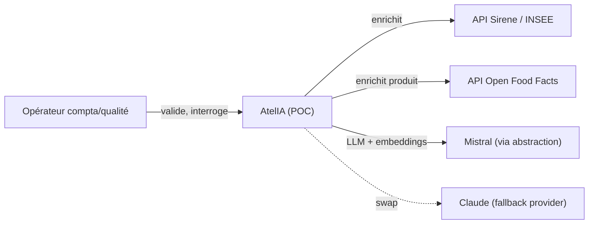
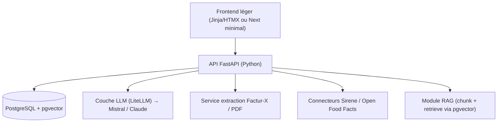

# Brief projet — POC AI Engineer · Conserverie du Val

> Document de cadrage destiné à l'implémentation (trio : Jérémy = décision, Claude = conseil/spec, Claude Code = implémentation).
> Nom de travail : **AtelIA** (atelier IA de la conserverie) — à renommer librement.

---

## 1. Pourquoi ce projet

Candidature au poste **Forward Deployed Engineer** dans une PME agroalimentaire (anonymisée ici en « Conserverie du Val », fictive) — PME agroalimentaire ~40 salariés, clients GMS, en pleine transformation IA/automatisation.

**Objectif du POC** : démontrer, sur leur terrain métier, qu'on sait livrer un système IA *en production, documenté, souverain*, avec le bon outil pour le bon problème — et pas une démo générique.

**Message à faire passer** (3 preuves) :
1. Je comprends **leur** problème daté et obligatoire (facture électronique).
2. Je distingue **function-calling** (données structurées) et **RAG** (documents non structurés) — maturité d'AI engineer.
3. Je construis **souverain** (Mistral, self-hosting, RGPD, contrôle humain) — exactement leur exigence « confidentialité et contrôle humain ».

---

## 2. Positionnement & garde-fous (à lire avant de coder)

- **Données** : uniquement **synthétiques** (factures générées) + **publiques** (API ouvertes). Jamais de données privées de l'entreprise. Présenté comme « prêt à brancher sur votre ERP via API ».
- **Pas une Plateforme Agréée (PA/PDP)** : c'est une certification réglementée. AtelIA est une **couche d'automatisation interne**, pas la plateforme légale d'émission/réception.
- **Humain dans la boucle obligatoire** : aucune écriture comptable sans validation d'un opérateur.
- **Provider-agnostic** : Mistral souverain par défaut, **swappable vers Claude** (leur outil) via une couche d'abstraction.
- **Timebox** : MVP livrable en 2-3 jours (Slices 0-1). Le reste est bonus. On livre des **tranches verticales**, jamais des couches horizontales à moitié.

---

## 3. Périmètre fonctionnel

### Module 1 — Agent « Factures fournisseurs » (cœur, function-calling)
Pipeline : **ingestion → extraction → enrichissement → contrôle → validation humaine → comptabilisation → dashboard de gains.**

- Ingestion d'une facture (Factur-X = PDF/A-3 avec XML embarqué ; fallback PDF simple via extraction LLM).
- Extraction structurée : fournisseur, SIREN/SIRET, lignes, HT/TVA/TTC, échéance.
- Enrichissement via **API Recherche d'entreprises / Sirene (INSEE)** — données réelles publiques.
- Contrôles : cohérence des totaux, taux de TVA, détection de doublons, score de confiance.
- **Écran de validation** : l'opérateur approuve/corrige avant écriture (contrôle humain).
- **Dashboard de gains** : heures économisées, coût/facture évité (réf. ~26 €/facture papier), délai de traitement, taux d'auto-extraction.

### Module 2 — Assistant « Qualité & Conformité » (RAG, optionnel/bonus)
Q&A à réponses **sourcées et citées** sur un corpus réglementaire public :
- Réforme **facturation électronique** (échéances, mentions obligatoires, e-reporting).
- **Règlement INCO 1169/2011** (étiquetage, allergènes) — ancrage métier food.
- Bonus food : enrichissement produit via **API Open Food Facts** (données réelles).

> Le contraste M1 (agent/function-calling sur données structurées) vs M2 (RAG sur documents) **est** le propos. Le défendre à l'oral = différenciateur majeur.

### Hors-périmètre (explicite)
Connexion à un vrai ERP ; statut de Plateforme Agréée ; multi-tenant ; authentification fine ; production réelle de TVA. Mentionné comme « étapes suivantes ».

---

## 4. Architecture (C4 simplifié)

### Niveau 1 — Contexte

### Niveau 2 — Conteneurs

---

## 5. Stack technique & justification

| Brique | Choix | Pourquoi |
|---|---|---|
| Langage/API | Python 3.12 + FastAPI | Stack Jérémy + stack annonce (Python) |
| Données | PostgreSQL + **pgvector** | Un seul moteur pour relationnel **et** vecteurs → simple, souverain |
| LLM + embeddings | **Mistral** (`mistral-large`, `mistral-embed`) | Souverain, français, adapté données sensibles |
| Abstraction LLM | **LiteLLM** | Provider-agnostic → swap Mistral ↔ Claude en config |
| Factur-X | lib `factur-x` + `lxml` | Extraction XML embarqué (PDF/A-3) |
| Frontend | Jinja/HTMX (défaut) ou Next minimal | Front léger, focus backend/IA. Next si polish voulu |
| Déploiement | Docker + **Coolify / Hetzner** | Standard Jérémy, HTTPS, backups PG quotidiens |
| Observabilité LLM | Log coût tokens + latence par appel | Touche AI-eng : montre le pilotage des coûts |
| Docs | README + arc42-lite + ADR + C4 (Mermaid) | Doc-as-code, Diátaxis |

---

## 6. Décisions d'architecture (ADR à formaliser)

- **ADR-001** — Mistral comme LLM par défaut derrière LiteLLM (souveraineté + swap Claude).
- **ADR-002** — Function-calling pour M1 (données structurées) **vs** RAG pour M2 (documents). Frontière assumée.
- **ADR-003** — pgvector plutôt qu'un vector store dédié (simplicité mono-base, souveraineté).
- **ADR-004** — Données synthétiques + API publiques uniquement (zéro donnée privée).
- **ADR-005** — Human-in-the-loop bloquant avant toute écriture comptable.

---

## 7. Sources de données (toutes réelles/publiques ou synthétiques)

| Source | Type | Usage |
|---|---|---|
| Factures générées (Factur-X) | Synthétique | Entrée M1 |
| API Recherche d'entreprises / Sirene (INSEE) | Réelle publique | Enrichissement fournisseur (SIREN→raison sociale, NAF, adresse) |
| Open Food Facts (API) | Réelle publique | Enrichissement produit (bonus food) |
| Textes réforme facture élec (economie/impots.gouv) | Réelle publique | Corpus RAG M2 |
| Règlement INCO 1169/2011 | Réelle publique | Corpus RAG M2 (allergènes/étiquetage) |

---

## 8. Découpe en tranches verticales (ordre de livraison)

- **Slice 0 — Socle déployé** : FastAPI + Postgres/pgvector + abstraction LiteLLM/Mistral + Docker + Coolify + healthcheck + `.fr` HTTPS. *Livrable : ça tourne en ligne.*
- **Slice 1 — M1 happy path** : 1 facture Factur-X → extraction → écran validation → 1 métrique de gain. *Livrable : POC complet et démontrable.* ⟵ **objectif minimal**
- **Slice 2 — M1 robustesse** : anomalies, doublons, enrichissement Sirene, fallback PDF/LLM, score de confiance.
- **Slice 3 — M2 RAG conformité** : corpus + Q&A sourcée et citée.
- **Slice 4 — Bonus** : Open Food Facts + polish UI + page « gains ».

> **Règle d'or** : à la fin de chaque slice, le système est déployé et démontrable. Si tu n'as que les Slices 0-1, tu as déjà un excellent POC.

---

## 9. Livrables finaux

1. App **déployée** (URL `.fr` HTTPS, Coolify/Hetzner, backups PG).
2. **README** clair : problème → solution → archi → lancement.
3. **Démo vidéo courte** (2-3 min) : ingestion → validation → gains.
4. Docs : arc42-lite + ADR + diagrammes C4 (Mermaid).
5. Dépôt GitHub propre (compte pro `sodigitaljeremy`).

---

## 10. Accroche pour la candidature (quelques lignes Indeed)

> Bonjour, plutôt que de vous parler de mon profil, je préfère vous montrer.
> Votre annonce mentionne la facture électronique : c'est une obligation qui démarre dès septembre 2026 (réception) et 2027 (émission) pour une PME comme la vôtre. J'ai donc commencé à construire **AtelIA**, un POC déployé et documenté : un agent IA (Mistral, souverain) qui ingère une facture, en extrait les données, détecte les anomalies, et la présente à un opérateur pour validation avant comptabilisation — avec mesure des heures économisées. Le tout self-hosté, données privées jamais exposées.
> Je vous envoie le lien dès la première tranche en ligne. Ex-commercial reconverti au dev, en Master Software Engineer (alternance), je code aujourd'hui les outils que j'utilisais avant.